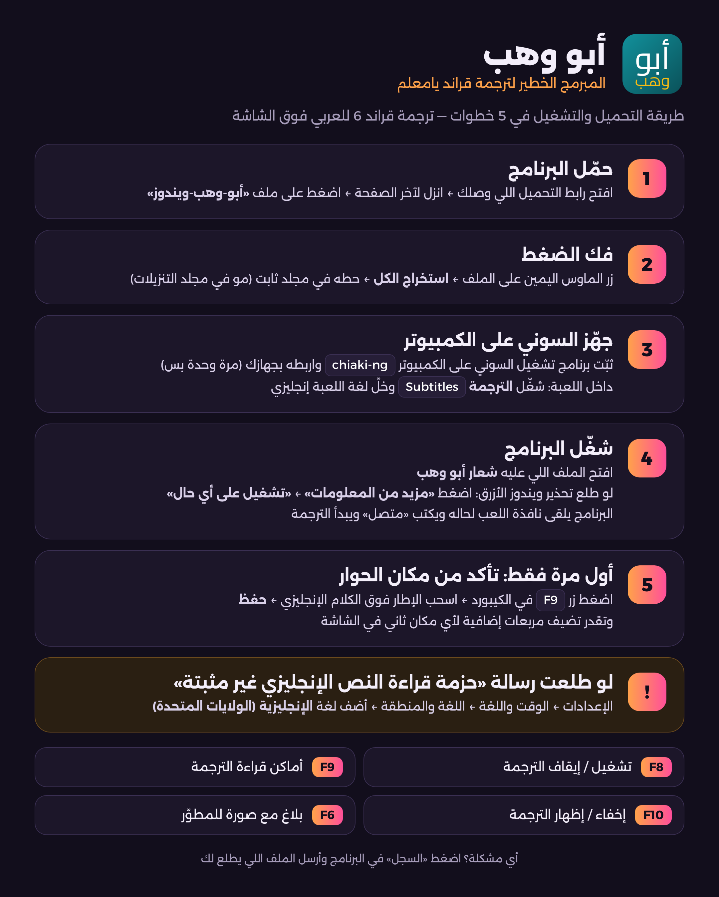

# أبو وهب — المبرمج الخطير لترجمة قراند يامعلم

برنامج ويندوز يترجم نصوص **GTA VI** للعربي فوق الشاشة وأنت تلعب: الحوارات، رسائل الجوال، القوائم، الشروحات.

- يشتغل فوق **chiaki-ng** أو **PS Remote Play** على البي سي، ويلقى نافذة اللعب لحاله.
- الترجمة مجانية عن طريق جوجل، ومايكروسوفت كخيار احتياطي.
- ما يلمس ملفات اللعبة، فما فيه أي خطر باند.

## التشغيل

1. حمّل البرنامج من هنا: **[تحميل أبو وهب](https://github.com/abowhb123/GTA-IV-ABO-WHB/releases/latest/download/AbuWahab-Windows.zip)**، فك الضغط، وشغّل الملف اللي عليه شعار أبو وهب.
2. شغّل السوني في chiaki-ng أو Remote Play.
3. البرنامج يلقى نافذة اللعب ويبدأ الترجمة لحاله، وتشوف «chiaki-ng متصل».

## الأزرار
| الزر | الوظيفة |
|---|---|
| **زر التشغيل الدائري** (F8) | تشغيل الترجمة أو إيقافها |
| **🎯 أماكن قراءة الترجمة** (F9) | مربع الحوار ومعه لين 5 مربعات إضافية. تسحب أي مربع، وتكبّره من الزوايا، وتضيف أو تحذف |
| **🎨 شكل الترجمة** | الأشكال الجاهزة، والخط، والسماكة، والحجم، والألوان، والشفافية، مع معاينة مباشرة |
| **📱 ترجمة الجوال والقوائم** | كل رسالة أو فقرة تنترجم فوق مكانها، بحجم يناسبها، وما تتداخل مع اللي جنبها |
| **🧹 فلتر النصوص الدخيلة** | يتجاهل اللوحات، وأزرار التحكم (SELECT وBACK)، والكتابة العربية، ونافذة البرنامج نفسه |
| **✏️ تصحيح الترجمات** | تصحح أي جملة، والبرنامج يتذكر تصحيحك دايم |
| **🚩 بلاغ مع صورة** (F6) | يحفظ صورة الشاشة مع الترجمة والسجل في مجلد «بلاغات» |
| F10 | إخفاء أو إظهار الترجمة |

> الصور العادية من ويندوز ما تطلع فيها الترجمة، لأن البرنامج يخفيها عن التصوير عشان ما يقرأها ويترجمها مرة ثانية. استخدم **F6**.

## حل المشاكل
- **ما لقى نافذة اللعب:** تأكد إن chiaki-ng أو Remote Play مفتوح ومو مصغّر، واضغط **تحديث**.
- **رسالة «حزمة قراءة النص الإنجليزي غير مثبتة»:** الإعدادات ← الوقت واللغة ← اللغة ← أضف **English (United States)**.
- **أي مشكلة ثانية:** اضغط **أرسل السجل** وأرسل ملف `log.txt`.

## الملفات
| الملف | المحتوى |
|---|---|
| `main.py` | الواجهة، ونافذة الترجمة فوق اللعبة، وإطار التحديد، وشكل الترجمة، والمحرك |
| `ocr_win.py` | قراءة النص بمحرك ويندوز، وفلتر الكلمات الإنجليزية |
| `translators.py` | ترجمة جوجل ومايكروسوفت، والتصحيحات |
| `words_en.txt` | قائمة كلمات إنجليزية للفلتر (من مكتبة wordfreq) |
| `fonts/` | خطوط Alexandria وCairo وTajawal وIBM Plex Sans Arabic وNoto Naskh Arabic (رخصة OFL) |
| `tests/smoke_windows.py` | اختبار تلقائي على ويندوز في GitHub Actions |
